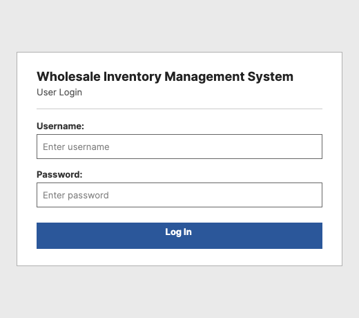
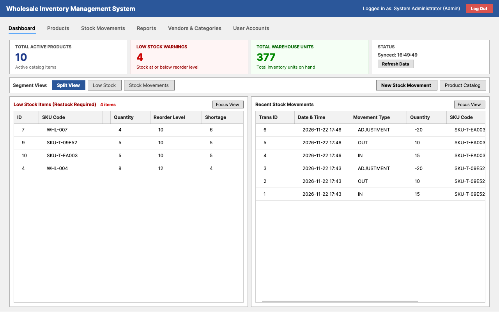
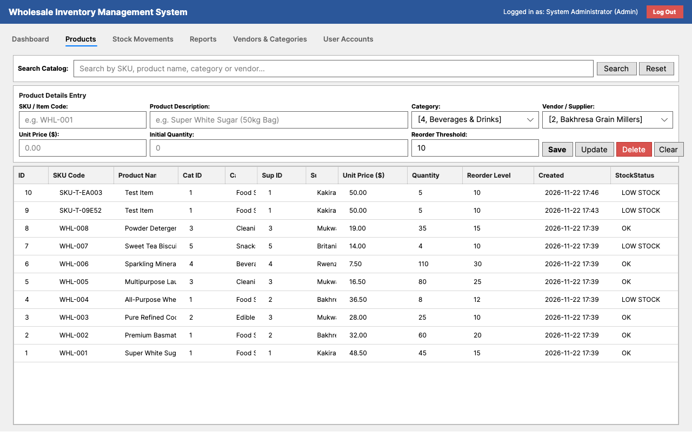
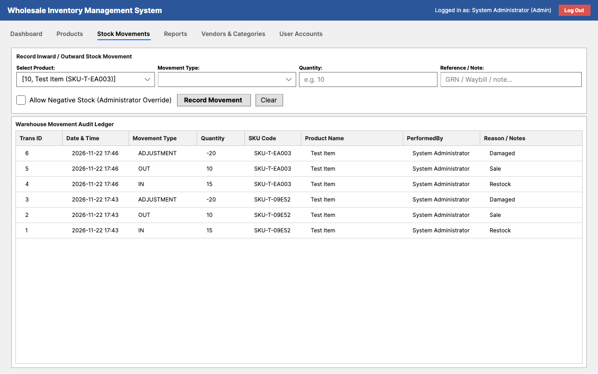
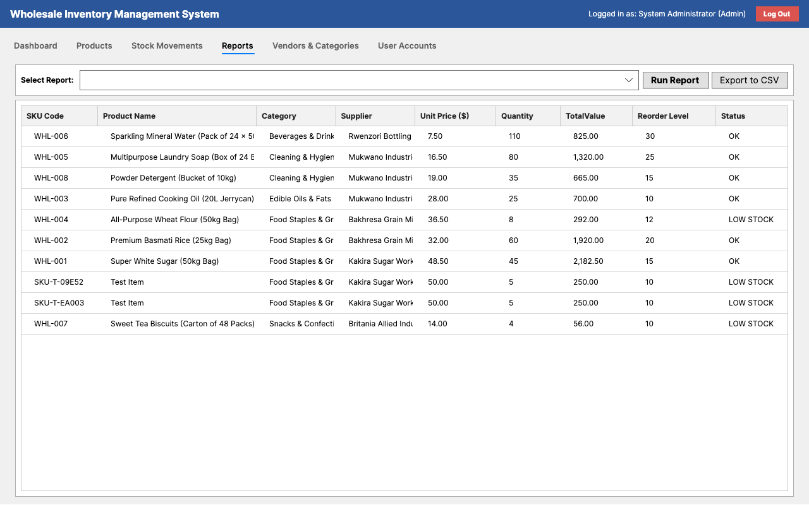
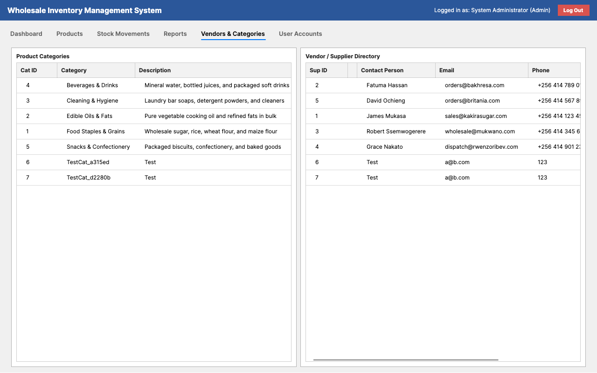
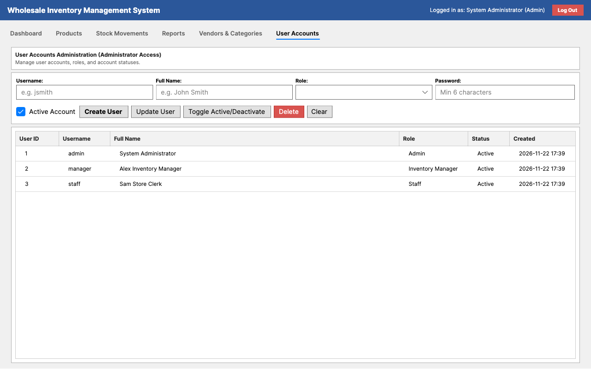

# Wholesale Inventory Management System

A desktop inventory system built with **C# .NET 8**, **Avalonia UI** (cross-platform for macOS and Windows), and **MySQL** database following strict **MVC (Model-View-Controller)** architecture.

---

## How It Works

1. **Sign In:** Authenticate using role-based credentials (Admin, Inventory Manager, Staff) secured with SHA-256.
2. **Dashboard Overview:** Monitor real-time total products, warehouse units, and immediate low-stock reorder warnings.
3. **Product Catalog:** Add, update, delete, and search products with SKU duplicate validation.
4. **Stock Movements:** Record Stock In, Stock Out, or Adjustments with automatic zero-floor stock protection.
5. **Valuation & Reports:** Generate inventory valuation reports and export records to CSV.

---

## How to Run

```bash
# Ensure MySQL is running on port 3306 (StockTrackDB database)
cd StockTrack.Avalonia
dotnet run
```

### Seeded Credentials

| Role | Username | Password | Access Level |
| :--- | :--- | :--- | :--- |
| **Admin** | `admin` | `admin123` | Full access, user accounts, negative stock override |
| **Inventory Manager** | `manager` | `manager123` | Products catalog, stock movements, valuation reports |
| **Staff** | `staff` | `staff123` | Catalog lookup, routine inward/outward dispatches |

---

## Application Forms & Screenshots

### 1. User Login Window
Secure authentication card with masked password entry and SHA-256 hash verification.


---

### 2. Operational Dashboard
Live summary KPI cards and split view for low-stock warnings and recent movements.


---

### 3. Product Catalog Management
Product details entry form with SKU validation, live keyword search, and catalog DataGrid.


---

### 4. Stock Movement & Ledger
Inward receipts, outward dispatches, damage adjustments, and immutable movement ledger.


---

### 5. Financial Valuation & Reports
Real-time stock valuation calculations with single-click CSV export.


---

### 6. Vendors & Categories Directory
Product category classifications and supplier contact directory.


---

### 7. User Accounts Administration
Administrator user provisioning, role assignments, and account active/deactivate controls.

